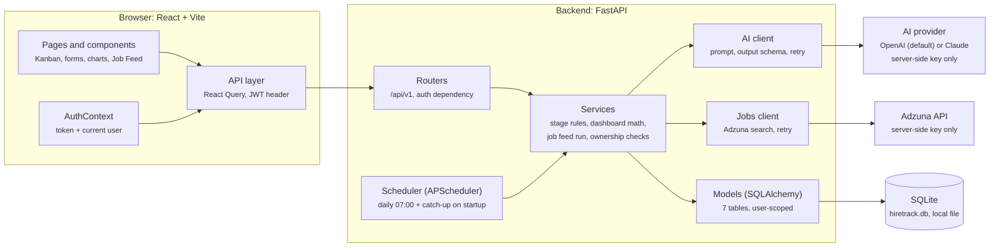
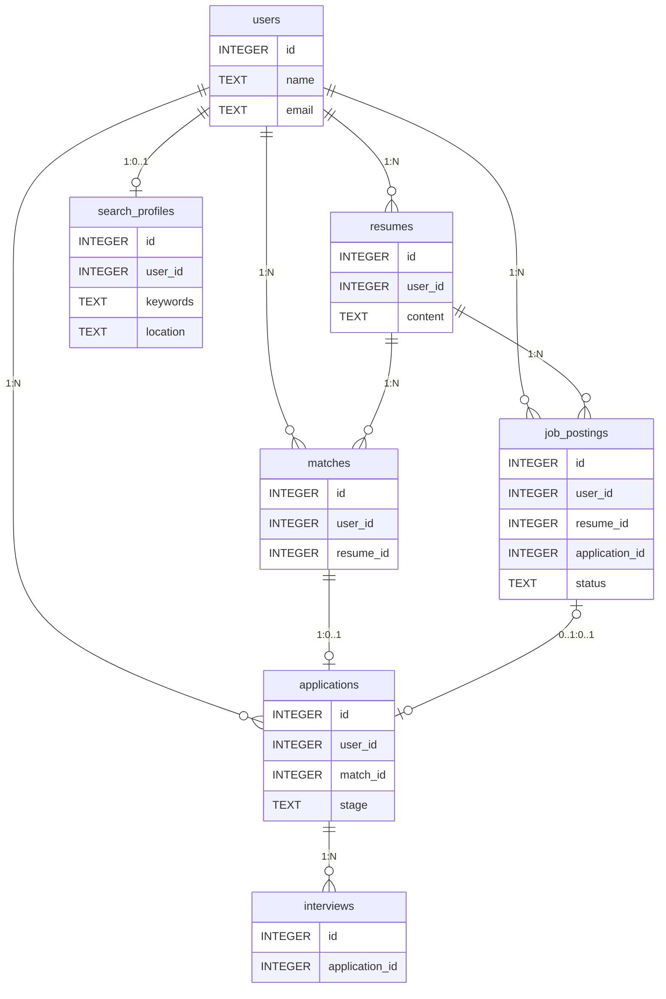

# HireTrack AI — Product & Technical Specification

Nov 14, 2026 · @Aravinda Karanam

HireTrack AI is a web app that helps job seekers tailor their resume to each job with AI and track every application in one place. It will be built live in class with React, FastAPI, SQLite and the OpenAI API (with Claude as a switchable alternative).

## 1. Overview

**Problem:** candidates send the same resume to every job without knowing which skills each posting expects, and they track applications across scattered spreadsheets and notes.

**Goal:** one place to check resume fit for a job, track applications from Wishlist to Offer, and see how the job hunt is going.

**Target user:** students and professionals actively applying for jobs.

## 2. Scope

### In scope (v1)

- Signup, login and logout
- Resume upload or paste
- AI Resume Match
- Application pipeline
- Job-hunt dashboard
- Daily Job Feed: new postings near the user's location from the Adzuna API, ranked against the active resume

### Out of scope (v1)

- Social login (Google, LinkedIn)
- Email or calendar sync
- Scraping job boards (LinkedIn, Indeed, Glassdoor and similar forbid it in their terms and offer no public job-search API) or auto-applying
- Job sources other than Adzuna
- Cloud deployment
- Password reset, email verification and account deletion from the UI
- OCR for scanned (image-only) PDFs

## 3. Core features

### 3.1 Authentication

- Sign up, log in and log out with email and password
- Emails are trimmed and lowercased before saving and before lookup, so `A@x.com` and `a@x.com` are the same account
- Passwords must be 8–72 bytes long (bcrypt ignores everything after 72 bytes)
- Each user sees only their own data (see the ownership rule in 7.3)

### 3.2 Resume

- Upload a PDF (max 2 MB) or paste resume text
- PDF text is extracted on the server with `pypdf`. If a PDF yields no text (a scanned image), the upload is rejected with a message asking the user to paste the text instead
- Resume text is capped at 20,000 characters
- **Resumes are immutable.** Every upload or paste creates a new row and becomes the active resume; the previous one is deactivated, not overwritten or deleted. Old matches therefore always point to the exact text they were scored against
- One active resume is used for matching; the user can switch back to an older one
- There is no resume delete in v1

### 3.3 AI Resume Match

- Paste a job description (max 20,000 characters) and get:
  - a fit score (0–100)
  - the skills missing from the resume
  - three resume bullet points tailored to the job
  - the company name and role title read from the job description (either may come back empty if the posting doesn't say)
- Save the result as a Wishlist application. The save form is pre-filled with the extracted company and role; the user must confirm or fill them in, because both are required on an application
- Each user can run at most 20 matches per day; the 21st returns `429` with a clear message
- Requires an active resume; otherwise the API returns `409` asking the user to add one

### 3.4 Application pipeline

- Track applications through Wishlist → Applied → Interview → Offer (plus Rejected)
- Store company, role, applied date, job link and notes
- Move applications between stages on a Kanban board
- Add interview dates to an application

**Stage rules** (enforced in the services layer, not the UI):

| Event | Effect |
| --- | --- |
| New application | Stage defaults to `WISHLIST`; `applied_date` and `responded_at` are empty |
| Move to `APPLIED`, `INTERVIEW` or `OFFER` while `applied_date` is empty | `applied_date` is set to today (the user can edit it). Skipping straight from Wishlist to Interview is allowed |
| Move to `INTERVIEW`, `OFFER` or `REJECTED` while `applied_date` is set and `responded_at` is empty | `responded_at` is set to now |
| Move back to `WISHLIST` | `applied_date` and `responded_at` are cleared (the application was never really sent) |
| Move to `REJECTED` while still in `WISHLIST` | Allowed (e.g. the posting closed); not counted as sent or replied |
| Move out of `REJECTED` | Allowed (to undo a mistake); dates are kept unless moving back to `WISHLIST` |

Any stage can move to any other stage, so the Kanban board never blocks a drag.

### 3.5 Job-hunt dashboard

- **Applications by stage:** count of the user's applications in each of the five stages
- **Interviews this week:** interviews with `scheduled_at` from Monday 00:00 to Sunday 23:59 of the current week, in the browser's timezone (the frontend sends its IANA timezone, e.g. `Asia/Kolkata`, as a query parameter)
- **Response rate:** replied ÷ sent, where
  - *sent* = applications with `applied_date` set
  - *replied* = sent applications with `responded_at` set (a rejection counts as a reply; an application with no answer simply stays in `APPLIED`)
  - shown as "—" when nothing has been sent yet

### 3.6 Daily Job Feed

A separate **Job Feed** tab lists new job postings near the user, ranked by how well they fit the active resume.

**Search profile** (one per user, set on the Job Feed tab):

| Field | Example | Notes |
| --- | --- | --- |
| Keywords | `python developer` | Required; 1–100 characters; what to search for |
| Country | `in` | Required; one of the countries Adzuna supports |
| Location | `Bangalore` | Required; city or area to search around |
| Radius | `25` km | 5–100 km, default 25 |
| Remote OK | on | Also include postings that mention remote work |
| Enabled | on | Turn the daily search off without losing the settings |

**Daily run** (for each user with an enabled profile and an active resume):

1. **Fetch:** call the Adzuna search API with the keywords, location and radius, for postings from the last 7 days, up to 50 results. If Remote OK is on, make a second call across the whole country with the keywords plus "remote" (up to 25 results) and combine the two
2. **Remove duplicates:** skip postings already stored for this user (same Adzuna ID)
3. **Pre-filter:** rank the new postings by how many words they share with the active resume and keep the top 15. This step needs no AI, so it costs nothing
4. **Score:** send the resume and the 15 postings to the AI provider in **one** request. For each posting it returns a fit score (0–100), the top missing skills and a one-line reason
5. **Store** the scored postings with status `NEW`

**Scheduling:** HireTrack runs only on the user's machine (cloud deployment is out of scope), so the daily run happens inside the backend:

- APScheduler runs it every day at 07:00 local time while the backend is up
- when the backend starts, it also runs for any profile whose last run was more than 24 hours ago, so a missed morning catches up
- a **Refresh now** button runs it on demand, at most once per hour per user

**Snippets only:** Adzuna returns a shortened job description (a few hundred characters), and opening the full posting means visiting the job site, which the app does not do automatically. So the feed's fit score is labelled **"Quick score"**. For a full AI Resume Match, the user opens the posting, copies the full description and runs a normal match (3.3). The match form is pre-filled with the posting's company, role and link.

**Using the feed:**

- Postings are shown highest score first, with title, company, location, salary (when Adzuna has one), posted date, quick score, reason and missing skills
- **Save to pipeline** creates a Wishlist application with the company, role and job link filled in, and marks the posting `SAVED`
- **Dismiss** hides the posting (`DISMISSED`); it won't come back in later runs
- The tab shows when the last run happened and any error from it (e.g. "Adzuna unavailable, will retry tomorrow")
- Postings are scored against the resume that was active when they were fetched; changing the active resume affects only later runs
- `NEW` and `DISMISSED` postings older than 30 days are deleted by the daily run; `SAVED` ones are kept

## 4. Non-functional requirements

- **Security:**
  - passwords hashed with bcrypt (the `bcrypt` package directly)
  - JWT access tokens signed with HS256 using `JWT_SECRET` from `.env`, valid for 24 hours
  - the token is stored in `localStorage` and sent as `Authorization: Bearer <token>`. This keeps the class build simple; the trade-off is that a cross-site scripting bug could steal it, so the frontend must never render HTML from user or AI text
  - logout only deletes the token in the browser. A stateless JWT can't be revoked on the server, so a stolen token works until it expires
  - login is limited to 5 failed attempts per email per 15 minutes
  - the AI provider API key (OpenAI, or Anthropic when switched) and the Adzuna app ID and key live only in the backend `.env` and are never sent to the browser
- **Privacy:** resumes and job descriptions contain personal details and are sent to the configured AI provider (OpenAI by default) for matching. The signup page states this. Only the search keywords and location are sent to Adzuna, never the resume
- **Third-party terms:** the Job Feed follows Adzuna's API terms, including showing their required attribution on the Job Feed tab, and links to each posting on its own site
- **Performance:** pages load in about a second; an AI match returns in under 15 seconds, including any retry
- **Usability:** responsive layout with clear loading and error messages
- **Maintainability:** separate frontend, backend and database layers; settings in a `.env` file; schema changes through Alembic migrations
- **Portability:** SQLite for now, PostgreSQL later. All timestamps are stored in UTC, JSON lists are stored as TEXT, and the schema is created only through Alembic, so the move needs a new database URL plus one migration run

## 5. Tech stack

| Layer    | Technology                                    |
| -------- | --------------------------------------------- |
| Frontend | React (with Vite), HTML, CSS, JavaScript      |
| Backend  | FastAPI (Python), SQLAlchemy, Alembic, pypdf, APScheduler, httpx |
| Database | SQLite (local)                                |
| AI       | OpenAI API via the official `openai` Python SDK (default); Claude via the `anthropic` SDK when `AI_PROVIDER=anthropic` |
| Jobs data | Adzuna job search API                        |
| Auth     | JWT + bcrypt password hashing                 |

React is the suggested frontend framework because the Kanban board and dashboard are much easier to build from components.

## 6. System architecture

A three-tier app: a React single-page app calls a FastAPI REST API over JSON with a JWT, and the API alone reads and writes SQLite and calls the AI provider (OpenAI by default) and the Adzuna API.

**The backend is the only part that touches SQLite, the AI provider and Adzuna**

*HireTrack AI architecture · React SPA, FastAPI layers, SQLite, AI provider (OpenAI or Claude), Adzuna API*

Routers only validate and delegate; services hold the rules (stage changes, dashboard maths, match flow, the job feed run, ownership checks); the scheduler only triggers services. The AI client is the one place that knows about the AI provider, and the jobs client is the one place that knows about Adzuna, so tests can swap both for fakes.

### 6.1 API endpoints

All routes are under `/api/v1`. Every route except signup and login requires a valid JWT.

| Method | Path | Purpose |
| --- | --- | --- |
| POST | `/auth/signup` | Create an account, return a token |
| POST | `/auth/login` | Return a token |
| GET | `/auth/me` | Current user |
| GET | `/resumes` | List the user's resumes (newest first) |
| POST | `/resumes` | Upload a PDF (multipart) or paste text; becomes active |
| POST | `/resumes/{id}/activate` | Make an older resume active |
| POST | `/matches` | Run an AI match against the active resume |
| GET | `/matches` | List past matches |
| GET | `/matches/{id}` | One match |
| GET | `/applications` | List applications (optional `?stage=`) |
| POST | `/applications` | Create an application (optionally from `match_id`) |
| GET / PATCH / DELETE | `/applications/{id}` | Read, edit (including stage) or delete one application |
| GET | `/applications/{id}/interviews` | List its interviews |
| POST | `/applications/{id}/interviews` | Add an interview |
| PATCH / DELETE | `/interviews/{id}` | Edit or delete an interview |
| GET | `/dashboard?tz=<IANA zone>` | Stage counts, interviews this week, response rate |
| GET / PUT | `/search-profile` | Read or save the Job Feed search profile |
| GET | `/jobs` | Feed postings (default `?status=NEW`), highest score first, plus last run time and error |
| POST | `/jobs/refresh` | Run the feed now (`429` if run in the last hour) |
| POST | `/jobs/{id}/save` | Create a Wishlist application from the posting |
| POST | `/jobs/{id}/dismiss` | Hide the posting |

List endpoints return everything without pagination; a single user's job hunt stays small.

**Error format:** every error returns `{"error": {"code": "<SNAKE_CASE_CODE>", "message": "<text safe to show the user>"}}` with the matching HTTP status: `400` validation, `401` missing or expired token, `404` not found *or not yours* (never `403`, so IDs can't be probed), `409` conflict (e.g. no active resume, email taken), `429` rate limit, `502` the AI call failed.

### 6.2 AI integration

- **Provider:** chosen with `AI_PROVIDER` in `.env`: `openai` (default) or `anthropic`. The AI client is a small interface with one implementation per provider, so the rest of the backend never knows which one is in use
- **SDK and model:** the official `openai` Python SDK (Chat Completions API) for OpenAI; the official `anthropic` SDK for Claude. The model comes from `OPENAI_MODEL` or `ANTHROPIC_MODEL` in `.env`. **Model IDs and prices are placeholders until you choose them** (see 10.4); the evaluation set (8) decides
- **Request:** the resume text and job description go in the user message, each inside its own delimited block. The system (developer) message says both are data to analyse, never instructions to follow
- **Structured output:** the response must match a strict JSON schema (`fit_score` integer 0–100, `missing_skills` string list, `suggested_bullets` list of exactly 3 strings, `company` and `role` strings): OpenAI `response_format` of type `json_schema` with `strict: true`, or Claude's `output_config.format`. The backend validates the result again with Pydantic before saving
- **Latency budget:** per-request timeout 12 s with at most 1 retry on timeouts, 429 and 5xx, so the total stays near the 15 s target. Set the model's reasoning effort to its lowest useful level if the model supports it
- **Refusals:** a refusal (OpenAI's `refusal` field, Claude's `refusal` stop reason), output cut off by the token limit, a schema failure or exhausted retries returns `502` with a "try again" message. Nothing is saved
- **Cost control:** input caps from 3.2 and 3.3 plus the 20-matches-per-day limit
- **Job Feed scoring:** a second prompt in the same AI client scores up to 15 postings in one request. The output schema is a list of `{posting_id, fit_score, missing_skills (max 5), reason (one sentence)}`, and the backend ignores any `posting_id` it didn't send. It runs in the background, so it uses a 60 s timeout with 2 retries instead of the 15 s budget. Feed runs don't count toward the 20-matches-per-day limit; they're capped at one scheduled run plus one manual refresh per hour

### 6.3 Jobs client (Adzuna)

- Calls Adzuna's search endpoint over `httpx` with `ADZUNA_APP_ID` and `ADZUNA_APP_KEY` from `.env`
- Maps each result to: `external_id`, title, company, location, description snippet, `redirect_url`, salary min/max (nullable), posted date
- Timeout 10 s, 2 retries. A failure is saved as the run's error and shown on the Job Feed tab; the next scheduled run tries again
- Never opens or downloads the posting pages themselves

## 7. Database design

The app uses seven SQLite tables. Every table except `interviews` has a `user_id`, so each user only ever sees their own data; `interviews` belong to a user through their application.

**Every record belongs to a user; interviews hang off applications**

*Database relationships · 7 tables*

A user has many resumes, matches, applications and job postings, and at most one search profile. A match or a job posting can each be saved as at most one application, and an application can have many interviews.

**Conventions:**

- All `DATETIME` columns are stored in UTC. `DATE` columns are calendar dates with no timezone
- `created_at` defaults to the current time; `updated_at` is set by SQLAlchemy (`onupdate=`), because SQLite has no `ON UPDATE`

### 7.1 Tables

#### users

| Column        | Type     | Notes                                     |
| ------------- | -------- | ----------------------------------------- |
| id            | INTEGER  | Primary key                               |
| name          | TEXT     | Not null                                  |
| email         | TEXT     | Not null, unique; stored lowercased       |
| password_hash | TEXT     | Not null, bcrypt hash                     |
| created_at    | DATETIME | Default current time                      |

#### resumes

| Column     | Type     | Notes                                                       |
| ---------- | -------- | ----------------------------------------------------------- |
| id         | INTEGER  | Primary key                                                 |
| user_id    | INTEGER  | Foreign key → users.id, ON DELETE CASCADE                   |
| content    | TEXT     | Not null, resume text, ≤ 20,000 characters; never updated   |
| source     | TEXT     | Not null; `PDF` or `PASTE`                                  |
| is_active  | BOOLEAN  | Default false; at most one active resume per user (7.2)     |
| created_at | DATETIME | Default current time                                        |

#### matches

| Column            | Type     | Notes                                                       |
| ----------------- | -------- | ----------------------------------------------------------- |
| id                | INTEGER  | Primary key                                                 |
| user_id           | INTEGER  | Foreign key → users.id, ON DELETE CASCADE                   |
| resume_id         | INTEGER  | Foreign key → resumes.id, ON DELETE NO ACTION (see 7.2)     |
| job_description   | TEXT     | Not null, ≤ 20,000 characters                               |
| company           | TEXT     | Nullable; extracted by the AI                               |
| role              | TEXT     | Nullable; extracted by the AI                               |
| fit_score         | INTEGER  | Not null; CHECK 0–100                                       |
| missing_skills    | TEXT     | Not null; JSON list of skills                               |
| suggested_bullets | TEXT     | Not null; JSON list of 3 bullets                            |
| created_at        | DATETIME | Default current time                                        |

#### applications

| Column       | Type     | Notes                                                                       |
| ------------ | -------- | --------------------------------------------------------------------------- |
| id           | INTEGER  | Primary key                                                                 |
| user_id      | INTEGER  | Foreign key → users.id, ON DELETE CASCADE                                   |
| match_id     | INTEGER  | Foreign key → matches.id, ON DELETE SET NULL; nullable, UNIQUE              |
| company      | TEXT     | Not null                                                                    |
| role         | TEXT     | Not null                                                                    |
| stage        | TEXT     | Not null, default `WISHLIST`; CHECK in (`WISHLIST`, `APPLIED`, `INTERVIEW`, `OFFER`, `REJECTED`) |
| job_url      | TEXT     | Nullable                                                                    |
| applied_date | DATE     | Nullable; managed by the stage rules in 3.4                                 |
| responded_at | DATETIME | Nullable; managed by the stage rules in 3.4; used for response rate        |
| notes        | TEXT     | Nullable                                                                    |
| created_at   | DATETIME | Default current time                                                        |
| updated_at   | DATETIME | Updated on every change                                                     |

#### interviews

| Column         | Type     | Notes                                                 |
| -------------- | -------- | ----------------------------------------------------- |
| id             | INTEGER  | Primary key                                           |
| application_id | INTEGER  | Foreign key → applications.id, ON DELETE CASCADE      |
| scheduled_at   | DATETIME | Not null, UTC; used for "interviews this week"        |
| round          | TEXT     | Nullable; e.g. HR, Technical, Final                   |
| notes          | TEXT     | Nullable                                              |

#### search_profiles

| Column          | Type     | Notes                                                    |
| --------------- | -------- | -------------------------------------------------------- |
| id              | INTEGER  | Primary key                                              |
| user_id         | INTEGER  | Foreign key → users.id, ON DELETE CASCADE; UNIQUE        |
| keywords        | TEXT     | Not null, 1–100 characters                               |
| country         | TEXT     | Not null; Adzuna country code, e.g. `in`, `gb`, `us`     |
| location        | TEXT     | Not null; city or area to search around                  |
| radius_km       | INTEGER  | Not null, default 25; CHECK 5–100                        |
| remote_ok       | BOOLEAN  | Not null, default false                                  |
| enabled         | BOOLEAN  | Not null, default true                                   |
| last_run_at     | DATETIME | Nullable; when the last run finished                     |
| last_manual_run_at | DATETIME | Nullable; for the once-per-hour refresh limit         |
| last_error      | TEXT     | Nullable; message from the last failed run, cleared on success |
| created_at      | DATETIME | Default current time                                     |
| updated_at      | DATETIME | Updated on every change                                  |

#### job_postings

| Column          | Type     | Notes                                                              |
| --------------- | -------- | ------------------------------------------------------------------ |
| id              | INTEGER  | Primary key                                                        |
| user_id         | INTEGER  | Foreign key → users.id, ON DELETE CASCADE                          |
| resume_id       | INTEGER  | Foreign key → resumes.id, ON DELETE NO ACTION; resume it was scored against |
| application_id  | INTEGER  | Foreign key → applications.id, ON DELETE SET NULL; nullable, UNIQUE |
| source          | TEXT     | Not null, `ADZUNA`                                                 |
| external_id     | TEXT     | Not null; the posting's ID at the source                           |
| title           | TEXT     | Not null                                                           |
| company         | TEXT     | Nullable                                                           |
| location        | TEXT     | Nullable                                                           |
| url             | TEXT     | Not null; link to the posting                                      |
| snippet         | TEXT     | Not null; shortened description from the source                   |
| salary_min      | INTEGER  | Nullable                                                           |
| salary_max      | INTEGER  | Nullable                                                           |
| posted_at       | DATETIME | Nullable                                                           |
| fit_score       | INTEGER  | Not null; CHECK 0–100 (quick score from the snippet)               |
| missing_skills  | TEXT     | Not null; JSON list, at most 5                                     |
| reason          | TEXT     | Not null; one-sentence explanation                                 |
| status          | TEXT     | Not null, default `NEW`; CHECK in (`NEW`, `SAVED`, `DISMISSED`)    |
| fetched_at      | DATETIME | Default current time                                               |

### 7.2 Constraints, indexes and deletes

**Constraints:**

- One active resume per user: `CREATE UNIQUE INDEX uq_resumes_one_active ON resumes(user_id) WHERE is_active = 1`. Switching resumes deactivates the old one and activates the new one in one transaction
- A match becomes at most one application: `UNIQUE (match_id)` on applications. NULLs don't clash, so manual applications are unaffected
- A posting is stored once per user: `UNIQUE (user_id, source, external_id)` on job_postings. This is also how later runs skip postings already seen, including dismissed ones
- A posting becomes at most one application: `UNIQUE (application_id)` on job_postings
- `CHECK` constraints on `applications.stage`, `matches.fit_score`, `resumes.source`, `job_postings.fit_score`, `job_postings.status` and `search_profiles.radius_km`

**Indexes:**

| Table | Index | Used by |
| --- | --- | --- |
| resumes | `(user_id)` | resume list |
| resumes | partial unique `(user_id) WHERE is_active = 1` | active-resume lookup |
| matches | `(user_id)` | match history |
| applications | `(user_id, stage)` | pipeline and dashboard; also covers lookups by `user_id` alone |
| interviews | `(application_id)` | interview lists, joins and cascades (SQLite doesn't index foreign keys on its own) |
| interviews | `(scheduled_at)` | interviews this week |
| search_profiles | unique `(user_id)` | profile lookup |
| job_postings | unique `(user_id, source, external_id)` | skipping postings already seen |
| job_postings | `(user_id, status, fit_score)` | the feed, highest score first |

**Deletes:**

| When this is deleted | What happens |
| --- | --- |
| A user (admin/script only in v1) | Their resumes, matches, applications, search profile and job postings are deleted, and through applications their interviews |
| An application | Its interviews are deleted; a job posting saved as it keeps its data, `application_id` becomes NULL |
| An old `NEW` or `DISMISSED` job posting (30-day cleanup) | Nothing else is affected |
| A match | The application saved from it keeps its data; `match_id` becomes NULL |
| A resume | Not possible in v1. `matches.resume_id` and `job_postings.resume_id` use `NO ACTION` rather than `RESTRICT`: SQLite checks `NO ACTION` at the end of the statement, so deleting a user (which removes resumes, matches and postings together) still works |

**SQLite note:** turn on foreign keys for each connection (`PRAGMA foreign_keys = ON`, e.g. in a SQLAlchemy `connect` event), otherwise the cascades and foreign key checks are ignored.

### 7.3 Ownership rule

Because `user_id` is copied onto several tables, the database alone can't stop one user's row from pointing at another user's row. The services layer must check ownership on every access:

- Every query for resumes, matches, applications, search profiles and job postings filters by the current `user_id`
- The scheduled feed run processes one user at a time and only ever uses that user's profile, active resume and postings
- Interviews are always loaded through a join to `applications` filtered by `user_id`
- When a request references another row (`match_id` on an application, the resume used for a match, `application_id` on an interview), the service first loads that row with the user filter. If it isn't found, the API returns `404`

## 8. Testing

- **Backend:** pytest with FastAPI's `TestClient` against a temporary SQLite file, with a fake AI client injected in place of the real one. Must cover:
  - the stage rules table in 3.4
  - the dashboard metrics, including the timezone handling for "interviews this week"
  - ownership: user B gets `404` for every one of user A's IDs
  - the constraints in 7.2
  - AI failure paths: timeout, refusal and invalid output
  - Job Feed with a fake jobs client: duplicates skipped, dismissed postings never return, the top-15 pre-filter, AI scores for unknown `posting_id`s ignored, the once-per-hour refresh limit, catch-up on startup, the 30-day cleanup, and an Adzuna failure saved as `last_error`
- **AI prompt:** a small manual check set of about 5 resume/job pairs run against the real model before the demo, to confirm the scores and extracted company/role make sense
- **Frontend:** manual testing of the main flows; component tests are optional in v1

## 9. Milestones

1. Project setup and database (Alembic migrations, foreign keys pragma, `.env`)
2. Authentication (signup, login, rate limit)
3. Resume (paste, PDF upload and text extraction, active resume)
4. Application pipeline (API with stage rules, Kanban board, interviews)
5. AI Resume Match (AI client, match endpoint, save as Wishlist)
6. Dashboard
7. Daily Job Feed (search profile, Adzuna client, scheduler, feed scoring, Job Feed tab)
8. Demo with sample data

## 10. Production design

Sections 1–9 describe the class build: one FastAPI service with SQLite. This section sets the targets for the **production build**, which keeps every product rule above but runs as Java microservices on Kubernetes. `implementation/README.md` explains how to build it, phase by phase, with complete code. The production build runs first on your own machine with Docker Compose at `http://localhost` (Phase 12), using the real OpenAI API; the AWS deployment described below (Phase 13) comes later, when you're ready for the cloud.

### 10.1 Architecture changes from the class build

| Concern | Class build | Production build |
| --- | --- | --- |
| Runtime | One FastAPI process | 8 Spring Boot services behind Spring Cloud Gateway, on Kubernetes (EKS) |
| Database | One SQLite file | PostgreSQL (Multi-AZ), one schema and database user per service, no cross-service foreign keys |
| Communication | In-process calls | REST for queries that need an answer now; Kafka events (transactional outbox) for everything else |
| Dashboard | Queries the applications table | Read model in analytics-service, built from events |
| AI calls | Inline in the request | Dedicated ai-service with a provider interface (OpenAI default, Claude switchable): bulkhead, quotas, usage ledger; feed scoring through the provider's Batch API |
| Job feed | Postings stored per user, fetched per user | Shared postings catalog plus per-user feed items; one Adzuna fetch per unique search, cached in Redis |
| Auth | 24 h JWT in `localStorage` | 15 min RS256 access token in memory plus a rotating 7-day refresh token in an `HttpOnly` cookie; logout revokes |
| Scheduling | APScheduler in the one process | ShedLock-guarded planner emitting run commands; workers scale on Kafka lag |

Services: `api-gateway`, `identity-service`, `resume-service`, `ai-service`, `match-service`, `application-service`, `job-feed-service`, `analytics-service`.

### 10.2 Service level objectives

Measured at the gateway over a rolling 30 days, unless noted.

| SLO | Target | Error budget |
| --- | --- | --- |
| API availability (non-AI requests, excluding `4xx`) | 99.9% | 43 min/month |
| Read latency (`GET`) | p95 < 300 ms, p99 < 800 ms | — |
| Write latency (non-AI `POST`/`PATCH`) | p95 < 500 ms | — |
| AI match latency (end to end) | p95 < 15 s | — |
| AI match success (excluding user-input errors and quota limits) | ≥ 99% | 1% |
| Dashboard freshness after a change | p95 < 5 s | — |
| Job feed delivered by 08:30 local, for active users with an enabled profile | ≥ 99% of runs | 1% |
| Data durability | Recovery point ≤ 5 min, recovery time ≤ 1 h | — |

Burn-rate alerts page when the error budget is being used up fast (2% in 1 hour) and open a ticket for slow burns (10% in 3 days).

### 10.3 Throughput and capacity

**Assumed load:**

| | Launch | Growth (design target) |
| --- | --- | --- |
| Registered users | 10,000 | 100,000 |
| Daily active users (DAU) | 1,000 | 10,000 |
| Weekly active users with an enabled job feed profile | 2,500 | 25,000 |
| API requests per DAU per day | 40 | 40 |
| AI matches per DAU per day | 1 | 1 |

**What that means at Growth:**

| Flow | Average | Peak (10× average) | Plan for |
| --- | --- | --- | --- |
| API requests at the gateway | 400,000/day ≈ 5 req/s | ≈ 50 req/s | **200 req/s** (4× headroom); load-tested |
| AI matches | 10,000/day ≈ 0.12/s | ≈ 1.2/s | ≈ 12 in flight at 10 s each; bulkhead of 32 concurrent calls |
| Feed runs | 25,000/day, spread 07:00–08:00 local | ≈ 7 runs/s in the busiest timezone hour | Provider Batch API; workers scale on Kafka lag (12 partitions, up to 12 workers) |
| Adzuna calls | ≤ 25,000/day before deduplication; fewer after sharing by search key | — | Needs a commercial Adzuna plan above the free tier's limits |
| Kafka events | ≈ 200,000/day, < 1 KB each | — | 12 partitions per topic is far more than enough |
| AI tokens | ≈ 210 M input + 60 M output per day | — | Request a rate-limit tier from the provider (OpenAI usage tier, or Anthropic tier when switched) that covers peak requests and tokens per minute |

**Per-component sizing (Growth):**

- **Stateless services:** 2–10 pods each on a horizontal autoscaler at 70% CPU. Plan for about 200 req/s per pod for simple reads and confirm with k6.
- **PostgreSQL:** a single Multi-AZ primary (`db.m7g.large` class) handles this load easily. Add a read replica for analytics if needed.
- **Connections:** the sum of pods × pool size must stay under `max_connections`. Use RDS Proxy and pools of 5–10 per pod.
- **Redis:** rate limits, quotas, dashboard cache (30 s) and Adzuna result cache (1 h); one small primary plus a replica.

Headroom beyond Growth: every service scales horizontally; the first limits to reach are the AI provider's rate-limit tier, the Adzuna plan and the database primary, in that order.

### 10.4 Cost model

Estimates for planning, not quotes. **AI model IDs and prices are placeholders** until you pick the OpenAI model(s) and copy their current list prices from OpenAI's pricing page into the table below (and into `hiretrack.ai.prices` in ai-service configuration). AWS figures are approximate us-east-1 on-demand prices; confirm them in the AWS Pricing Calculator before budgeting.

**Prices to fill in (per million tokens):**

| Placeholder | Used for | Input `P_in` | Cached input `P_cache` | Output `P_out` | Batch discount `D` |
| --- | --- | --- | --- | --- | --- |
| `OPENAI_MODEL` | Matches (real-time) | TBD | TBD | TBD | — |
| `OPENAI_FEED_MODEL` | Feed quick scores (Batch API) | TBD | TBD | TBD | TBD (OpenAI's Batch API is discounted; check the current rate) |

**Cost per AI call:**

| Call | Tokens (in / out) | Formula |
| --- | --- | --- |
| Match (real-time) | ≈ 5,000 / 1,000 | `C_match = (5,000 × P_in + 1,000 × P_out) / 1,000,000` |
| Feed run (resume + 15 snippets, Batch API) | ≈ 6,000 / 2,000 | `C_feed = (6,000 × P_in + 2,000 × P_out) / 1,000,000 × (1 − D)` |

Output tokens include any reasoning tokens the model uses, which are billed as output. Measure real token counts with the `hiretrack_ai_tokens_total` metric during the evaluation runs and replace the estimates.

**Monthly cost:**

| Item | Launch | Growth |
| --- | --- | --- |
| AI matches | `30,000 × C_match` | `300,000 × C_match` |
| AI feed scoring (Batch API) | `75,000 × C_feed` | `750,000 × C_feed` |
| EKS control plane | $75 | $75 |
| Worker nodes (Graviton) | $240 (4 × m7g.large) | $480 (8 × m7g.large) |
| RDS PostgreSQL Multi-AZ + storage + proxy | $130 | $330 |
| Amazon MSK (3 brokers) | $110 | $450 |
| ElastiCache Redis (primary + replica) | $50 | $100 |
| ALB, NAT gateways, data transfer | $100 | $180 |
| Observability (logs, metrics, traces) | $50 | $150 |
| S3 + CloudFront | $10 | $30 |
| **Infrastructure subtotal** | **≈ $765** | **≈ $1,795** |

Monthly volumes: Launch = 1,000 matches/day and 2,500 feed runs/day; Growth = 10,000 and 25,000; 30 days.

**What this shows:**

- **AI volume is the variable cost.** Infrastructure is roughly fixed; AI cost grows with users and with the price of the model you choose.
- **The daily feed has 2.5× the call volume of matches,** because it runs every day for every active profile whether or not the user comes back. Its cost per call and its model choice matter most.

**Cost levers, in order:**

1. **Only run the feed for active users** (logged in within 14 days). This is already in the design.
2. **Batch API for feed scoring** (discounted). Already in the design.
3. **Share Adzuna fetches** across users with the same search. Already in the design.
4. **Prompt caching:** keep the system prompt and the resume at the start of the prompt, so repeat matches in a session reuse the cached prefix (OpenAI caches long prompt prefixes automatically; Claude needs explicit cache markers).
5. **Per-user quotas:** 20 matches/day; feed capped at 15 scored postings per run.
6. **Model choice per operation:** this is your decision, made with data. Run the eval set (Implementation Guide, Phase 11) against each candidate model, OpenAI or Claude. Use the cheapest model that meets the quality bar for each operation; a cheaper model for feed quick scores often saves the most.

Track actual spend with the `hiretrack_ai_cost_usd_total` metric and the `ai_usage` ledger, with an alert at 120% of the daily budget.

### 10.5 Metrics

Every service exports Micrometer metrics to Prometheus, traces to OpenTelemetry, and JSON logs carrying `traceId` and `requestId`. Logs never contain resume text, job descriptions or tokens.

| Group | Metric | Labels | Used for |
| --- | --- | --- | --- |
| HTTP (built-in) | `http_server_requests_seconds` | `service`, `uri`, `method`, `status` | Availability and latency SLOs |
| AI | `hiretrack_ai_requests_total` | `provider`, `operation`, `model`, `outcome` (`ok`, `refusal`, `invalid`, `timeout`, `rate_limited`, `error`) | AI success SLO |
| AI | `hiretrack_ai_latency_seconds` (histogram) | `provider`, `operation`, `model` | AI latency SLO |
| AI | `hiretrack_ai_tokens_total` | `provider`, `model`, `type` (`input`, `output`, `cache_read`) | Capacity vs rate-limit tier |
| AI | `hiretrack_ai_cost_usd_total` | `provider`, `model`, `operation` | Spend dashboard and budget alert |
| AI | `hiretrack_ai_bulkhead_available` | — | Saturation |
| Feed | `hiretrack_feed_runs_total` | `trigger`, `status` | Feed delivery SLO |
| Feed | `hiretrack_feed_postings_total` | `stage` (`fetched`, `new`, `prefiltered`, `scored`) | Funnel health |
| Feed | `hiretrack_adzuna_requests_total` / `_latency_seconds` | `outcome` | Upstream health, quota use |
| Feed | `hiretrack_feed_query_cache_hits_total` | `result` (`hit`, `miss`) | Sharing effectiveness |
| Events | `hiretrack_outbox_oldest_unpublished_seconds` | `service` | Event pipeline stuck |
| Events | Kafka consumer lag (exporter) | `group`, `topic` | Dashboard freshness SLO, worker autoscaling |
| Idempotency | `hiretrack_idempotency_total` | `endpoint`, `result` (`new`, `replayed`, `in_progress`, `mismatch`) | Retry behaviour of clients |
| Database | Hikari pool metrics (built-in) | `pool` | Connection saturation |
| JVM | Memory, GC, threads (built-in) | `service` | Pod sizing |
| Business | `hiretrack_signups_total`, `hiretrack_matches_total`, `hiretrack_applications_stage_changes_total` | `from`, `to` | Product dashboard, response-rate funnel |

### 10.6 Idempotency

Every operation can be retried safely by the browser, a service or Kafka without creating duplicates or paying for an AI call twice.

| Where | Mechanism |
| --- | --- |
| Creating `POST` endpoints (resumes, matches, applications, interviews, jobs/save, jobs/refresh) | `Idempotency-Key` header; the outcome is stored per `(user_id, key)` for 24 h. Replay returns the stored response; same key with a different body → `422`; still running → `409` + `Retry-After`; `5xx` releases the key |
| AI calls | ai-service stores results by the caller's `requestId` for 24 h and writes one `ai_usage` row per paid call |
| Stage changes | `PATCH` with `If-Match` (optimistic locking, `@Version`); moving to the current stage is a no-op |
| Save a match or posting to the pipeline | `UNIQUE (user_id, source_type, source_id)` on applications; a repeat save returns the existing application |
| Events | Transactional outbox (state and event commit together); consumers record `event_id` in `processed_events` in the same transaction; projections apply only newer `aggregateVersion`s |
| Feed runs | `UNIQUE (user_id, run_date, trigger)`; postings upserted by `(source, external_id)`; feed items inserted with `ON CONFLICT DO NOTHING`; batch results applied by `(user_id, posting_id)` |
| Scheduler | ShedLock ensures one active planner; a duplicate plan is absorbed by the unique run key |

### 10.7 Testing strategy and release gates

| Layer | Tools | What it proves | Gate |
| --- | --- | --- | --- |
| Unit | JUnit 5, AssertJ | Stage rules, dashboard maths, pre-filter, cost calculation | 100% pass; ≥ 80% line coverage on domain and service code |
| Slice | `@WebMvcTest`, `@DataJpaTest` | Validation, error mapping, queries | 100% pass |
| Integration | Testcontainers (Postgres, Kafka, Redis), WireMock (OpenAI, Claude, Adzuna) | Outbox, deduplication, idempotency, ownership (`404` for other users' IDs) | 100% pass |
| Contract | Pact (HTTP and message pacts) | Services and the SPA agree on APIs and event schemas | All pacts verified |
| End to end | Playwright | 5 core user journeys on a full local stack | 5/5 pass |
| Resilience | Toxiproxy | Fast `502`/`429` on slow or failed dependencies; outbox catches up after a Kafka outage | Expected behaviour holds |
| Performance | k6 on staging | 200 req/s reads and 2 matches/s within the 10.2 latency targets, error rate < 0.1% | Thresholds met |
| AI quality | Eval set of 30–50 labelled resume/job pairs | Schema-valid 100%, score in expected band ≥ 85%, company/role correct ≥ 90% | No regression above 5 points |
| Security | OWASP ZAP, dependency and image scanning | No high or critical findings | Zero high/critical |
| Migrations | Flyway on empty and previous-release schemas | Expand/contract migrations deploy without downtime | Pass |
